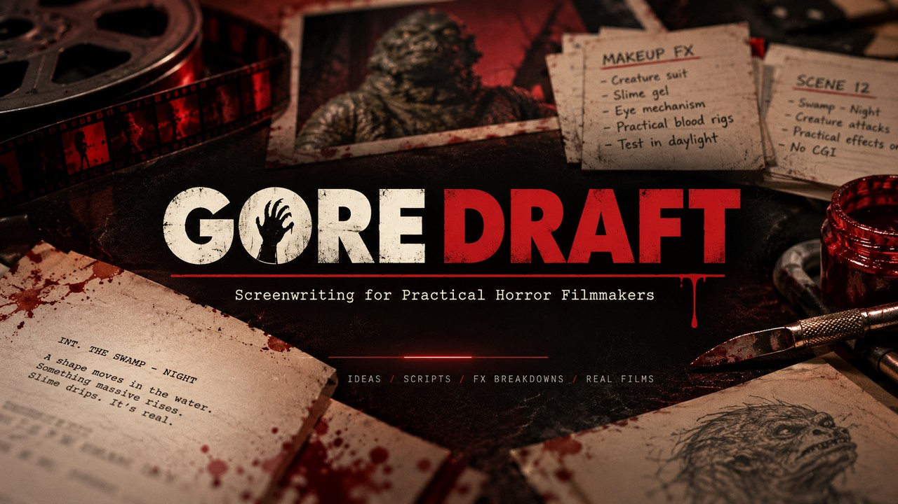
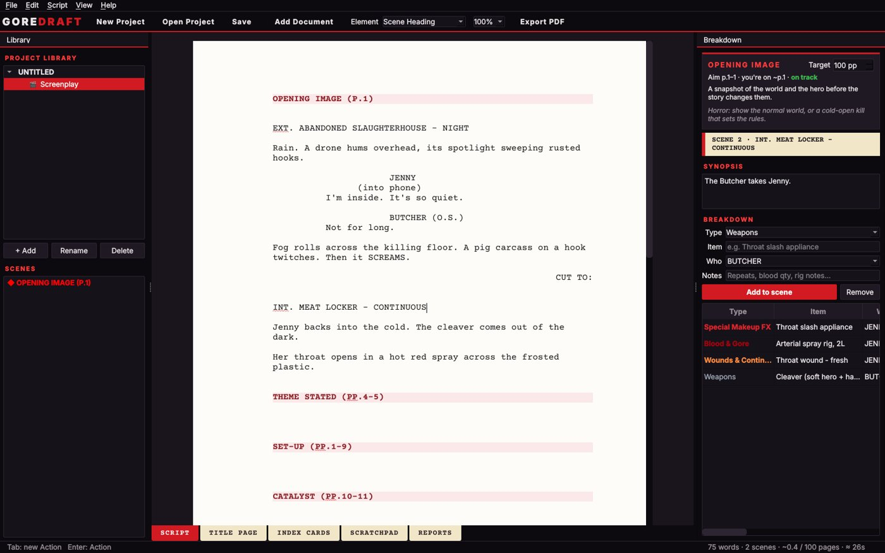
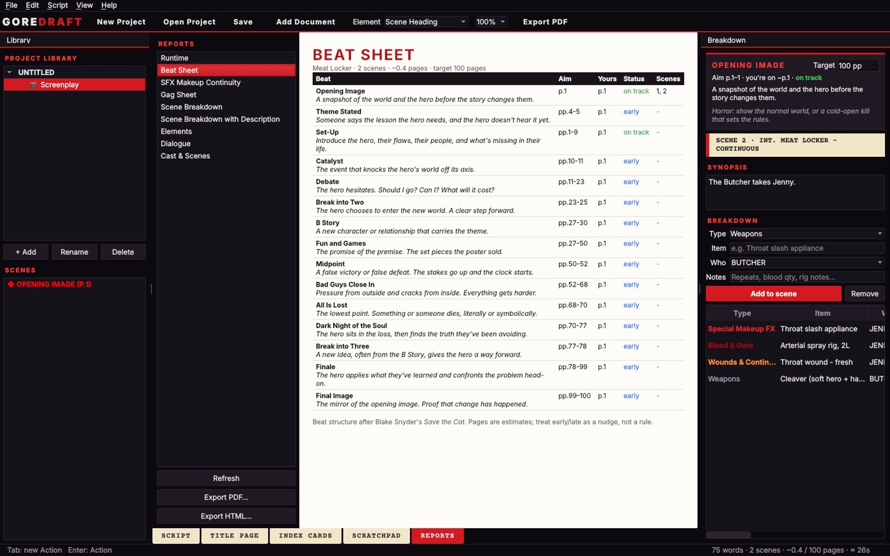
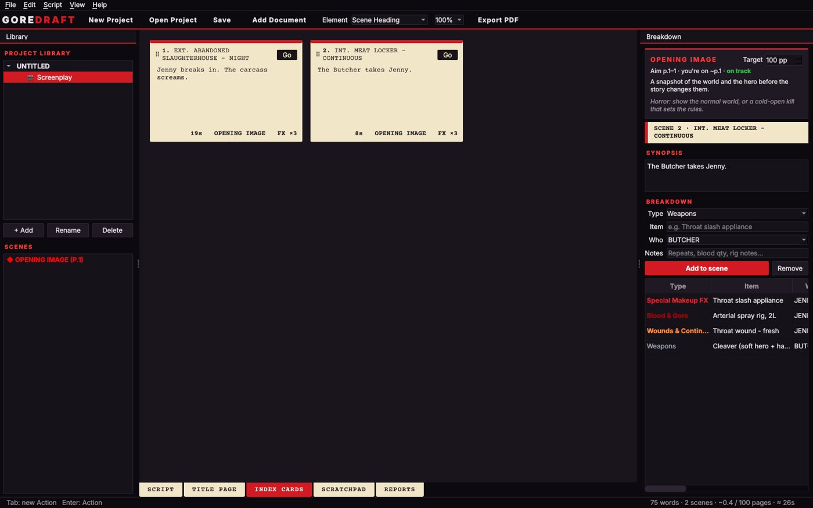

<p align="center">
  
</p>

<p align="center">
  <a href="https://github.com/splattervhs/GoreDraft/releases/latest"></a>
  <a href="https://github.com/splattervhs/GoreDraft/releases"></a>
  <a href="https://splattervhs.com"></a>
</p>

# GORE DRAFT

**Screenwriting for practical horror filmmakers.** A desktop script and novel writer for Windows and Linux, built the way classic desktop screenwriting apps used to work, around the thing other screenwriting apps ignore: **the effects.**

### Why we built it

We had dozens of horror screenplays written in the old Celtx desktop app, and we wanted to keep editing them **offline**, on our own machines, without a subscription. So [Splatter VHS](https://splattervhs.com) built GORE DRAFT. It opens those old `.celtx` projects and saves them as plain files you own. Then we gave it the thing every horror script needs: a proper effects breakdown, from a filmmaker with 20+ years in practical SFX.

### ⬇ [Download the latest beta](https://github.com/splattervhs/GoreDraft/releases/latest)

| | |
|---|---|
| **Windows** | `GoreDraft-Setup-x.y.z-beta.exe`: run the installer. Windows may say *"Windows protected your PC"* because the beta isn't code-signed yet. Click **More info → Run anyway**. |
| **Linux / Chromebook** | `GoreDraft-x.y.z-linux-x86_64.tar.gz`: unpack it and run `GoreDraft/GoreDraft`, or run `install.sh` to add it to your menu. Chromebooks need Linux turned on and an Intel or AMD processor. |

<p align="center">
  
</p>

## Why it exists

- **Effects-first breakdowns.** Tag Special Makeup FX, prosthetics, blood rigs, wounds, creature FX, animatronics, fog & haze, drones and pyro scene by scene.
- **SFX Makeup Continuity report.** Every wound, every character, in scene order, so you can count your repeats before you're on set.
- **Gag Sheet.** A printable workshop checklist with Built, Tested and On set boxes for every gag.
- **Save the Cat beat guide.** Pre-filled beats with target pages, and a live "you're running long" warning, with a horror note on every beat.
- **Classic desktop feel.** Tab and Enter element flow, index cards, scratchpad, title page, reports. **Imports Celtx 2 (`.celtx`), Final Draft (`.fdx`) and Fountain**, so your old scripts come with you.
- **Novels too.** Keep the script and the novelisation in one project.
- **Runtime, word count, spellcheck.** It knows Australian spelling and effects vocabulary.
- **Your work is yours.** Projects are plain Fountain and Markdown files in a folder you choose. No account, no cloud, no subscription. If GORE DRAFT vanished tomorrow, your scripts would still open in Notepad.

<p align="center">
  
  
</p>

## Beta testers

Thanks for helping. **[BETA.md](BETA.md)** covers what to try and how to report problems. The short version: in the app, use **Help → Report a Problem**. It fills in your version and error log for you.

---

## Run it from source

You need Python 3.10 or newer.

**Windows:** double-click `run_windows.bat`. The first run installs PySide6 (about 100 MB), then opens the app.

**Linux:** run `./run_linux.sh`. If `pip` complains about an "externally managed environment", the script creates a local `.venv` automatically.

**Manual:**
```
pip install -r requirements.txt
python run.py
python run.py "path/to/My Film/My Film.goredraft"   # open a project directly
```

## Build a standalone app (no Python needed to run it)

PyInstaller can't cross-compile, so build on the OS you're targeting.

- Windows: `build_windows.bat` creates `dist\GoreDraft\GoreDraft.exe`
- Linux: `./build_linux.sh` creates `dist/GoreDraft/GoreDraft`

Zip the `dist/GoreDraft` folder to move it to another machine.

## Download numbers

Run `python tools/stats.py` for a per-file, per-version breakdown. The badge at the top of this page shows the running total.

## Releasing a beta

1. In `goredraft/support.py`, set `FEEDBACK_EMAIL` to the address where testers' reports should go.
2. Bump `APP_VERSION` in `goredraft/model.py`.
3. Push the folder to a GitHub repository, then tag the version:
   ```
   git tag v0.2.0
   git push origin v0.2.0
   ```
4. GitHub builds three files and puts them in a **draft pre-release** under *Releases*:
   - `GoreDraft-Setup-0.2.0.exe` (Windows installer)
   - a Windows portable zip
   - a Linux `.tar.gz`
5. Check the draft, then press **Publish**. Send testers the release link. `BETA.md` becomes the release notes.

If the repository is private, testers need GitHub accounts and access. If that's a hassle, download the files from the release yourself and share them by Google Drive.

---

## What's in it

| Tab | What it does |
|---|---|
| **Script** | Screenplay page with Tab/Enter element flow (see keys below) |
| **Title Page** | Title, credit, author, based on, draft, copyright, contact |
| **Index Cards** | One card per scene. Edit synopses, see the beat and FX count, click Go to jump |
| **Scratchpad** | Free notes per document, saved alongside it |
| **Reports** | Runtime, Beat Sheet, SFX Makeup Continuity, Gag Sheet, Scene Breakdown, Elements, Dialogue, Cast. Export as PDF or HTML |

**Novels:** use **Add Document → Novel / prose**. Lines starting with `# ` become chapters in the sidebar. Supports `*italic*`. Export to PDF or Markdown.

### Reordering scenes

- **Drag** a scene (or a beat marker) up or down in the **Scenes** list on the left.
- **Drag** an index card by its header onto another card. Drop on the left half to place it before that card, or the right half to place it after.
- **Ctrl+Shift+Up / Down** moves the scene the cursor is in.

A scene's text, synopsis and breakdown items all move together. **Ctrl+Z** undoes a move.

### Runtime and word count

The status bar shows word count, page count and estimated running time, for example `≈ 1h 32m`. Select text to see a word count for just the selection.

The estimate uses page-a-minute. If your FX-heavy scripts play long, change the ratio under **View → Minutes per Page**.

The **Runtime** report lists every scene with its length in eighths of a page, its estimated time, and the timecode where it starts. Index cards show each scene's time too. Novels show word count and reading time.

### Spellcheck

Misspelt words get a red squiggle. **Right-click** one for suggestions, **Add to dictionary**, or **Ignore all**.

What it accepts and skips:
- Australian and British spelling (colour, realise, theatre)
- Film and effects vocabulary (squib, animatronic, hazer, prosthetics)
- A few Aussie words (arvo, ute, servo)
- Anything in ALL CAPS
- Your characters' names

Turn it on or off with **F7** (View → Check Spelling). Your dictionary is saved on your computer and shared across projects.

### Breakdown (right panel)

Put the cursor in a scene, then add items. You can also select text in the script, right-click, and choose **Tag as…**.

The effects categories come first and feed the Gag Sheet: Special Makeup FX, Prosthetics & Appliances, Blood & Gore, Wounds & Continuity, Creature FX, Dummies & Body Parts, Animatronics, Practical / Mechanical FX, Fog & Haze, Drones, and Pyro. After those come the usual production categories: props, weapons, wardrobe, cast, stunts, vehicles, and so on.

The **Who** field matters. The **SFX Makeup Continuity** report groups every makeup effect by character in scene order, so you can track a wound through the film and count the repeats you need to build.

The **Gag Sheet** is a printable workshop checklist with Built / Tested / On set boxes for each gag.

### Save the Cat beat guide

Start a screenplay from **Save the Cat beat sheet**, or use **Script → Insert Save the Cat Beats**. This adds 15 red beat markers to the script, each showing its target page for your chosen length. Beat markers never print.

As you write, the panel at the top right shows:
- which beat you're in
- where that beat should land
- the page you're on now
- whether you're early, on track, or running long
- a short guide line, with a horror-specific nudge

The **Beat Sheet** report shows the whole structure against your actual pages.

Use **Ctrl+]** and **Ctrl+[** to jump between beats.

## Keyboard flow

| On a… | Tab (finished line) | Tab (empty line) | Enter |
|---|---|---|---|
| Scene Heading | new Action | Action | Action |
| Action | new Character | Character | Action |
| Character | new Parenthetical | Transition | Dialogue |
| Parenthetical | new Dialogue | Dialogue | Dialogue |
| Dialogue | new Parenthetical | Parenthetical | Character |
| Transition | new Scene Heading | Shot | Scene Heading |

Other shortcuts and behaviours:
- Enter on an **empty** Character or Dialogue line turns it into Action.
- Typing `INT.` or `EXT.` on an Action line turns it into a Scene Heading.
- Typing `CUT TO:` turns the line into a Transition.
- `Ctrl+1` through `Ctrl+8` set the element directly.
- `Ctrl+Shift+Up / Down` moves the current scene.
- `F7` turns spellcheck on or off.

## Files

```
My Film/
  My Film.goredraft        small JSON list of documents
  docs/Screenplay.fountain the script (standard Fountain)
  docs/Novel.md            prose documents
  scratch/*.txt            scratchpads
  backups/                 automatic backup every 3 minutes while there are unsaved changes
```

Breakdown items are stored inside the Fountain file as notes, for example:
```
INT. MEAT LOCKER - CONTINUOUS
= The Butcher takes Jenny.
[[BD Special Makeup FX: Throat slash appliance @JENNY // 3 repeats]]
```
Other Fountain apps ignore these notes, so nothing breaks and nothing is lost. Beats are standard Fountain sections (`# Catalyst (pp.10-11)`).

## Import and export

- **Import:** Fountain, Final Draft `.fdx`, and **old Celtx 2.x `.celtx` desktop projects**
- **Export:** PDF (A4 or Letter, under File → PDF Page Size), Fountain, Final Draft `.fdx`, Markdown

## Known limits (beta)

- **PDF pagination is close, not Final Draft-exact.** It doesn't yet add (MORE)/(CONT'D) on dialogue split across pages, and a scene heading can end up at the bottom of a page. Fine for drafts. Check before sending to a producer.
- **Celtx import** reads documents (with their Celtx names and order), scratchpads, and the scene catalog. Sketches, storyboards, calendars and index-card colours have no text, so they are skipped.
- **No revision colours or scene locking yet.**
- **The novel editor is deliberately simple:** Markdown text, chapters, and word count.

Script font: Courier Prime (SIL Open Font License, see `goredraft/fonts/OFL.txt`). Beat structure follows Blake Snyder's *Save the Cat*; the guide text is original.

---

<p align="center">
  <b>GORE DRAFT</b> is a <a href="https://splattervhs.com">Splatter VHS</a> production. Ideas / Scripts / FX Breakdowns / Real Films.
</p>

<sub>Celtx and Final Draft are trademarks of their respective owners. GORE DRAFT is an independent app and is not affiliated with or endorsed by them; it can import their file formats so your old work isn't stranded.</sub>
